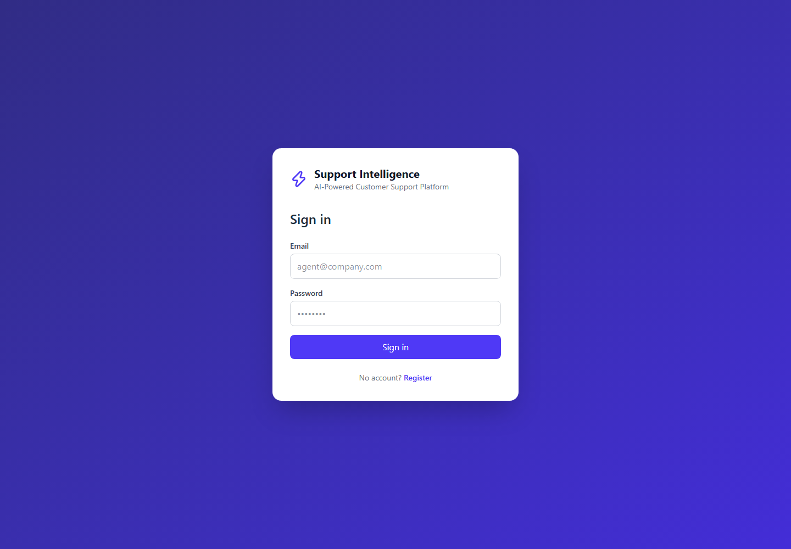
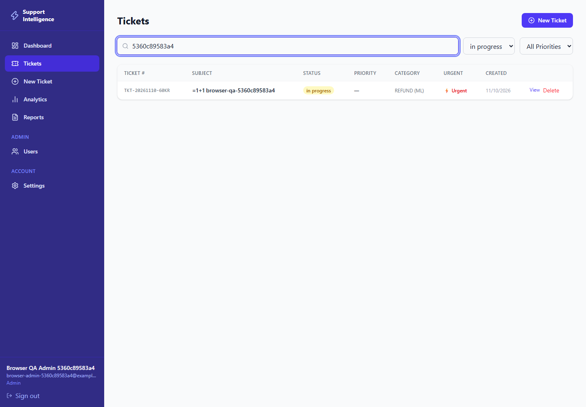
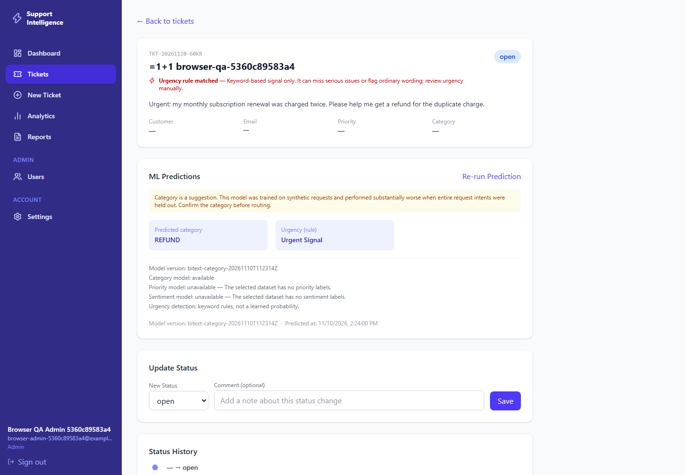
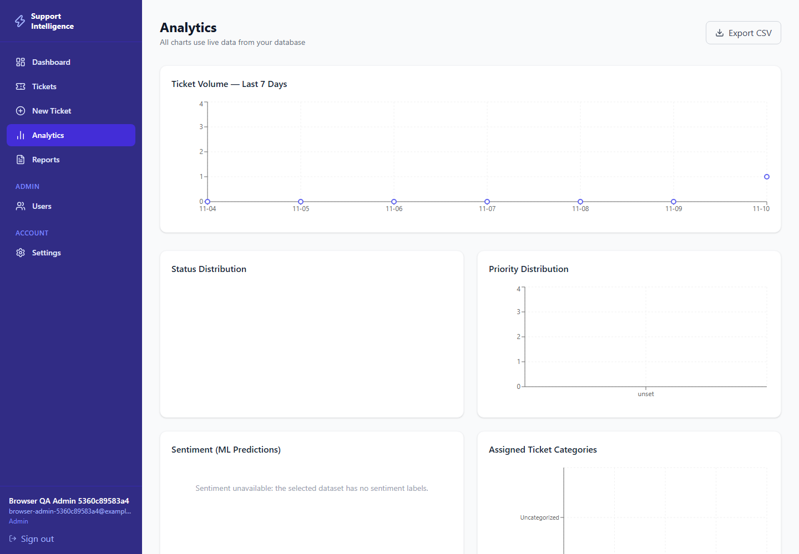
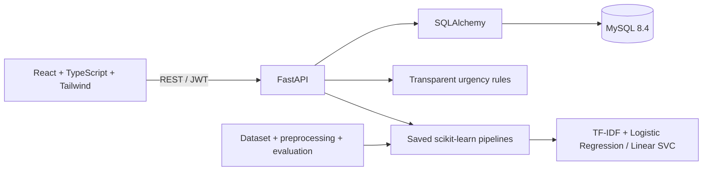

# AI-Powered Customer Support Intelligence Platform

A local full-stack customer support platform for teams that need to organize incoming requests, triage tickets, track status changes, and review workload trends. Support agents can create and manage tickets; administrators can manage users. A scikit-learn model suggests a ticket category, while analytics are calculated from persisted MySQL records.

The application combines a React and TypeScript frontend with a FastAPI backend, MySQL persistence, and a TF-IDF text-classification pipeline. Category predictions are suggestions for human review. The model was evaluated on a synthetic dataset and is not validated for real customer traffic.

## Screenshots

These screenshots show the local application workflow:

| Sign in | Dashboard |
| --- | --- |
|  |  |

| Ticket list | Ticket details and category suggestion |
| --- | --- |
|  |  |



## Current project status

- Existing React application builds successfully with `npm run build` (Node 22.17.1).
- Route-level loading reduced the main JavaScript chunk to 331.42 KB (gzip 108.19 KB); the separate Recharts chunk is 403.36 KB (gzip 113.68 KB). The production build still emits upstream `use client` warnings from React Router/lucide-react.
- Python 3.11.9 is installed from the standard per-user installer and the project `venv` works. The original environment is preserved as `venv_broken_backup`.
- MySQL 8.4.7 is running locally. Latest full backend/dataset/model suite with real MySQL enabled: 33 passed, 0 failed, 0 warnings.
- Browser-based end-to-end verification now passes with Playwright's compatible Chromium against the live frontend/API/MySQL. The workflow verified registration/login, roles, ticket prediction and persistence, history/audit, search/filter, analytics, CSV export, logout, and 390px responsive layouts. Genuine captures are in [`docs/screenshots`](docs/screenshots/); the runnable workflow is `scripts/browser_e2e.py`.
- Security review: public registration now defaults to Support Agent, local admin bootstrap uses a hidden password prompt, new passwords require 12 characters, and JWT verification uses PyJWT 2.15.1 with HS256 only. Full findings, residual risks, and audit limitations are documented in [`docs/testing.md`](docs/testing.md).
- The project source code is licensed under the MIT License; see [`LICENSE`](LICENSE). This licence applies to project code only and does not change the Bitext dataset's separate CDLA-Sharing-1.0 terms or attribution requirements.
- The full dependency-resolving Python audit reports zero known vulnerabilities across 53 distributions; `pip check` and the frontend production dependency audit are clean. Exact changes and the retained JSON report are in [`docs/testing.md`](docs/testing.md) and [`docs/python-dependency-audit.json`](docs/python-dependency-audit.json).
- The original random-split synthetic benchmark remains recorded (0.9989 accuracy, 0.9990 macro F1). Repeated prompt structures appeared across its splits, so these results are overly optimistic for generalization. A stricter intent-held-out evaluation scores 0.6542 accuracy and 0.5018 macro F1 across nine testable categories. Predictions are category suggestions, and performance on unseen intents is limited. See [`docs/grouped_evaluation_report.md`](docs/grouped_evaluation_report.md).
- Bitext's synthetic customer-service dataset is downloaded locally, validated, and used for a category-only TF-IDF benchmark. Raw CSV, processed splits, and model artifacts are Git-ignored.
- The dataset is synthetic; neither evaluation estimates performance on real ticket traffic. Whole intents are held out in the grouped stress test, but related phrasing may still cross different intents.
- Priority and sentiment models are unavailable because the selected Bitext dataset has no such labels. Urgency remains a transparent keyword rule.
- The alternative Tobi ticket dataset is CC BY-NC 4.0 and was not downloaded or used.

## Architecture



The API persists users, tickets, predictions, status transitions, and audit events. Dashboard counts and charts come from persisted ticket records. Predicted fields are separately stored and shown as predictions. Rule-based urgency is kept separate from ML priority labels.

## Technology

| Layer | Tools |
| --- | --- |
| Frontend | React, TypeScript, Vite, Tailwind CSS, React Router, Axios, Recharts |
| API | FastAPI, Pydantic, Uvicorn, SQLAlchemy |
| Database | MySQL 8.4, InnoDB, foreign keys and indexes |
| ML | Pandas, NumPy, scikit-learn, TF-IDF, Logistic Regression, Linear SVC |
| Tests | Pytest, FastAPI TestClient, SQLite test database, opt-in local MySQL integration suite |

## Setup on Windows

Prerequisites: Python 3.11, Node.js 22, npm, and MySQL 8.4. Open PowerShell in the project directory:

```powershell
.\scripts\setup.ps1
```

Setup installs project packages into the local virtual environment and frontend. It creates a local `.env` with a generated secret if none exists. Set `DB_PASSWORD` in `.env` in a local editor; never share it in chat.

Check the local server login from PowerShell. MySQL's `-p` prompt does not echo the password; do not put a password in the command line:

```powershell
mysql -u root -p -e "SELECT VERSION() AS mysql_version, CURRENT_USER() AS authenticated_as;"
```

After confirming the account works, run the project helper in PowerShell:

```powershell
.\scripts\setup_mysql.ps1
```

The helper asks for the database password with a hidden prompt, uses the existing `DB_HOST`, `DB_PORT`, `DB_NAME`, and `DB_USER` values from `.env`, applies `database/schema.sql`, verifies the tables, keys and indexes, stores the password in the ignored local `.env`, and runs the full suite including the real-MySQL integration tests. It refuses schema statements other than `CREATE DATABASE/TABLE IF NOT EXISTS` and the matching `USE`; it does not drop or overwrite existing tables. The default database name is `customer_support_db`. Do not include the password in terminal command arguments, logs, or chat.

Create the first administrator from a local terminal after MySQL/schema setup. Public registration creates Support Agent accounts only; the first visitor cannot claim administrator rights. The local bootstrap command prompts for email/name and reads the password with a hidden prompt. It refuses to create an admin if one already exists:

```powershell
.\venv\Scripts\python.exe .\scripts\create_admin.py
```

New account and password-change passwords must be at least 12 characters. Existing accounts remain valid; users can change their password in Settings.

Run the full test suite (the default run uses SQLite):

```powershell
.\venv\Scripts\python.exe -m pytest tests -v
```

To run the actual-MySQL integration tests separately after configuring `.env`, opt in as follows. These tests check schema keys/indexes, API health, persisted auth/roles, ticket CRUD and status history, audit events, filtering/pagination, and CSV formula escaping. They create uniquely named records and clean up only those records:

```powershell
$env:RUN_MYSQL_INTEGRATION = '1'
.\venv\Scripts\python.exe -m pytest tests\test_mysql_integration.py -v
Remove-Item Env:\RUN_MYSQL_INTEGRATION
```

To run the SQLite, dataset/model, and MySQL tests together, set the flag before invoking pytest. The latest full run was verified on 2026-11-10 with **33 passed, 0 failed, 0 warnings**; the six MySQL tests passed against the actual local MySQL database. Registration validation still uses Pydantic `EmailStr`; the integration fixture uses unique UUID-based `@example.com` addresses. The application has no mail-sending code, so these test registrations do not send messages. Detailed coverage and browser verification are in [`docs/testing.md`](docs/testing.md).

```powershell
$env:RUN_MYSQL_INTEGRATION = '1'
.\venv\Scripts\python.exe -m pytest tests -v
Remove-Item Env:\RUN_MYSQL_INTEGRATION
```

Start the API and website with one command:

```powershell
.\scripts\start.ps1
```

Open <http://localhost:5173>. API docs: <http://localhost:8000/docs>. Stop only the processes recorded by the project startup script:

```powershell
.\scripts\stop.ps1
```

If PowerShell blocks `.ps1` scripts, run the project script in a terminal configured to allow local scripts; the setup script does not change machine-wide execution policy.

## Browser end-to-end check

The optional local Playwright workflow uses a matched Chromium build with software rendering. Install it in the existing venv and run it while the local MySQL and project servers are available:

```powershell
& .\venv\Scripts\python.exe -m pip install playwright
& .\venv\Scripts\python.exe -m playwright install chromium
& .\venv\Scripts\python.exe .\scripts\browser_e2e.py
```

The script refuses to seed a nonempty MySQL users table, creates unique temporary QA records, verifies them in MySQL, and cleans up only those records. For this isolated empty database test only, set `ALLOW_FIRST_USER_ADMIN=true` in the PowerShell session before starting the API; the normal `.env.example` default is `false`. Start the app, run the script, then stop the app and remove the temporary environment variable. The script saves actual browser screenshots in `docs/screenshots/`. Chrome/Edge on this machine crashed in headless rendering; the compatible Playwright Chromium browser completed the UI workflow. See [`docs/testing.md`](docs/testing.md) for exact results and limits.

## First account and permissions

Administrators can view/update users and delete tickets. Public registrations receive the Support Agent role. Create the initial administrator with `scripts/create_admin.py`. Agents can create and manage tickets and view analytics. Use a strong password and do not expose a local database to the internet.

## Machine learning and data

Research, licenses, source structure, local data-quality findings, and limitations are in [`docs/dataset_review.md`](docs/dataset_review.md). The downloader fetches a pinned Bitext source CSV and verifies its size and SHA-256. It refuses to overwrite an existing raw file. The data is synthetic and its labels model service intents, not real ticket traffic.

```powershell
.\venv\Scripts\python.exe .\ml\download_dataset.py
.\venv\Scripts\python.exe .\ml\preprocess.py
.\venv\Scripts\python.exe .\ml\train_models.py
```

Preprocessing validates source labels, scans text columns for PII-like patterns without printing matched values, removes repeated normalized instructions, and writes the original stratified random train/validation/test splits with no exact text overlap. TF-IDF is fit only on training examples. Logistic Regression and Linear SVC are compared on validation macro F1; the selected model is evaluated once on held-out test data. A separate whole-intent holdout stress test is documented in [`docs/grouped_evaluation_report.md`](docs/grouped_evaluation_report.md); it leaves two single-intent categories unevaluated. See [`docs/model_status.md`](docs/model_status.md) for model version and task availability. The trained Linear SVC exposes no calibrated probabilities, so the API returns null confidence rather than inventing one. Priority and sentiment are not trained without labels. Urgency is a transparent keyword rule with stated limitations.

After training or replacing model files, restart the API so it reloads the local artifacts. `GET /api/predictions/status` reports loaded model availability and version.

## API overview

All application endpoints are under `/api` and require bearer authentication except registration, login, and `/health`.

| Area | Routes |
| --- | --- |
| Auth | `POST /auth/register`, `POST /auth/login`, `POST /auth/logout`, `GET /auth/me` |
| Users | `GET /users`, `GET /users/{id}`, `PATCH /users/{id}`, `POST /users/me/change-password` |
| Tickets | `POST /tickets`, `GET /tickets`, `GET /tickets/{id}`, `PATCH /tickets/{id}`, `DELETE /tickets/{id}`, `POST /tickets/{id}/predict`, `GET /tickets/export/csv` |
| Model predictions | `GET /predictions/status`, `POST /predictions/category`, `POST /predictions/priority`, `POST /predictions/sentiment` |
| Analytics | `GET /analytics/dashboard`, `GET /analytics/audit-logs` |
| Health | `GET /health`, `GET /health/database` |

FastAPI generates interactive docs at `/docs` when the API is running.

## Database tables

`users`, `tickets`, `ticket_predictions`, `ticket_status_history`, and `audit_logs`. User roles are stored as a constrained `admin`/`agent` enum in the current schema. `database/schema.sql` is an idempotent initial schema script; there are no Alembic revisions yet.

Architecture and trust boundaries are described in [`docs/architecture.md`](docs/architecture.md). The full local test/build record is in [`docs/testing.md`](docs/testing.md).

## Tests and builds

```powershell
.\scripts\test.ps1
Push-Location frontend; npm run build; Pop-Location
```

The SQLite tests use a temporary database. The opt-in MySQL integration suite uses the configured local MySQL server and verifies actual database persistence, model inference, and MySQL schema behavior. The suite also validates the local source checksum, processed splits, and saved category artifact.

## Project code licence

The project source code in this repository is licensed under the [MIT License](LICENSE). This licence does not apply to the Bitext dataset or other third-party materials. The Bitext source remains subject to CDLA-Sharing-1.0 and its attribution and sharing terms; see [`docs/dataset_review.md`](docs/dataset_review.md).

## Limitations and next steps

- Bitext is synthetic, and its template variations may overlap semantically across random splits; reported metrics do not establish performance on real customer support traffic.
- Bitext data publication has CDLA-Sharing-1.0 attribution and share-alike conditions. Do not commit the local raw copy. Review rights before distributing model artifacts.
- The unselected Tobi dataset is CC BY-NC 4.0 and is not used by this project.
- Passwords in `.env` remain local configuration; `.env` is git-ignored.
- Bearer access tokens are stored in browser `localStorage`; an XSS flaw could expose them. Logout discards the browser token but does not revoke a copied token before its one-hour expiry.
- Login has no server-side rate limiting or account lockout. Put a rate-limiting reverse proxy in front of any network-accessible deployment.
- This is a local portfolio prototype, not production-hardened software. Use HTTPS, least-privilege database credentials, managed secrets, security monitoring, and a reviewed deployment configuration before exposing it to a network.
- The latest full Python dependency audit resolved and checked all 53 distributions from `backend/requirements.txt` and reported zero known vulnerabilities. A secret scan found no actual credentials; its nine unverified results were source checksums and test-only dummy values, reviewed manually. The fresh local Git index is under review; no commit history exists.
- Add Alembic migrations, a normalized roles table, production-grade token revocation, and real consented customer-ticket evaluation before treating the application as production software.
- No deployment has been configured or published.

## Resume description

Built a full-stack customer-support ticket platform with a React/TypeScript interface, FastAPI services, SQLAlchemy persistence, role checks, ticket status history, analytics, CSV export, and a locally trained TF-IDF category classifier evaluated on a synthetic dataset. Reported metrics are not evidence of real-world ticket performance.

Interview walkthrough notes: [`docs/interview_notes.md`](docs/interview_notes.md).
