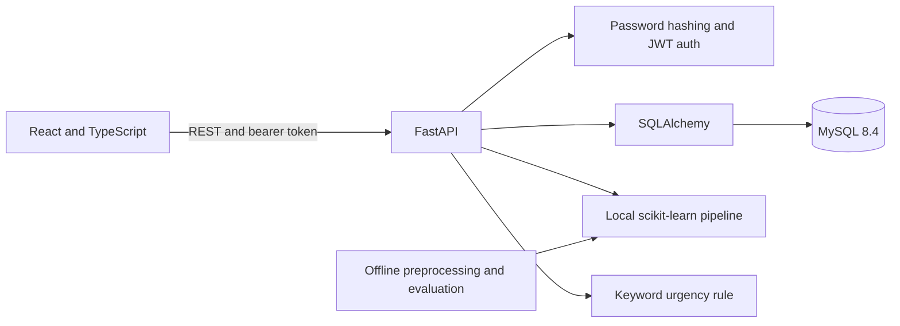

# Application architecture

This is a local full-stack support-ticket application. Its code and data paths are organized as follows:

## Runtime flow

- React routes render login/registration and protected ticket, dashboard, analytics, reports, settings, and admin user pages. Page modules are loaded on demand. Ticket predictions and dashboard statistics are requested from the API; they are not hardcoded sample values.
- FastAPI validates request/response shapes with Pydantic, verifies bearer tokens, checks admin-only endpoints, and uses SQLAlchemy sessions connected to the configured MySQL database.
- Passwords are stored as Passlib hashes. Ticket status changes, ticket predictions, and audit events are persisted in MySQL.
- The category model is loaded from the local ignored `ml/models/` artifact. Unsupported priority and sentiment tasks return unavailable. Urgency is a transparent keyword rule.
- The offline pipeline reads the original ignored CSV, validates labels, creates reproducible splits, fits TF-IDF on training data, and writes local model/evaluation artifacts.

## Trust and security boundaries

- `.env`, raw/processed data, and model artifacts are excluded by `.gitignore`. They must remain local unless the dataset and model distribution terms have been reviewed.
- The frontend stores bearer tokens in `localStorage`; this is vulnerable to token theft if an XSS issue is introduced. A production design should prefer secure, HttpOnly, SameSite cookies and a CSRF strategy.
- Logout removes the token from the browser and records an audit event, but the API uses stateless JWTs and does not revoke a copied token before its expiry.
- The current local configuration uses the owner-provided MySQL root account. A deployed instance should use a dedicated least-privilege database account, TLS, managed secrets, and hardened network access.
- Current registration accepts passwords of at least six characters. Raise the policy and add rate limiting before production use.
- This repository is not deployed; CORS, secrets, database access, migrations, monitoring, backups, and operational incident response need deployment-specific review.
